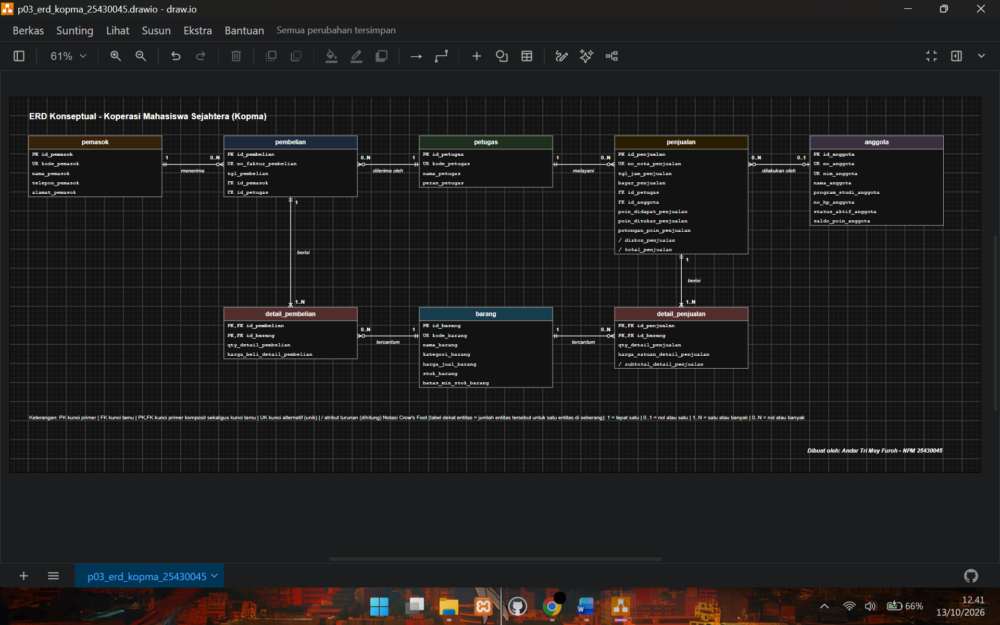
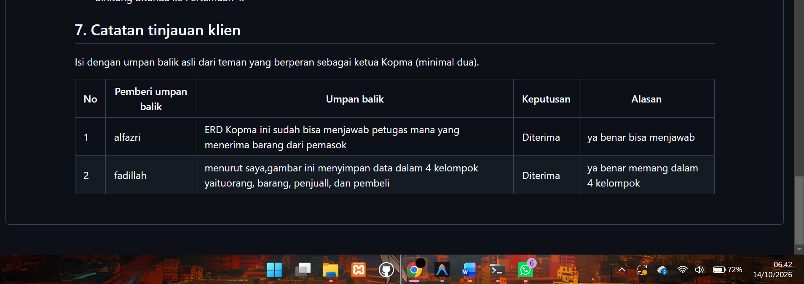
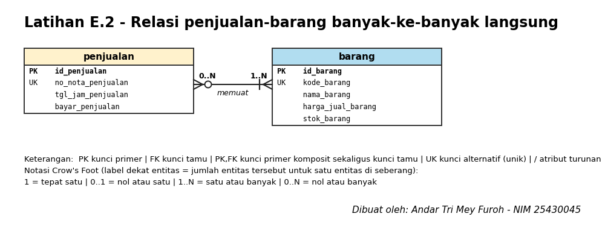
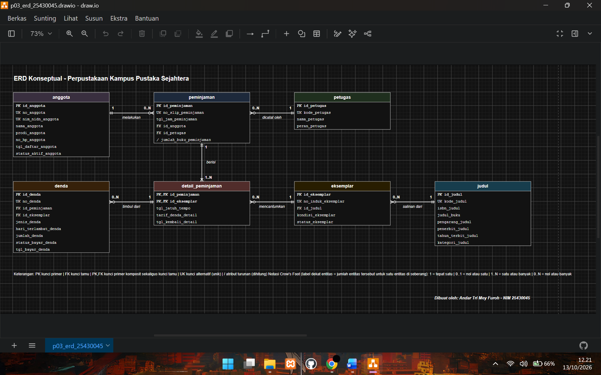

# Laporan Praktikum Basis Data - Pertemuan 03

**Nama:** Andar tri mey furoh   **NIM:** 25430045    **Kelas:** B   **Tanggal:** 14 Oktober 2026

**Asisten/Dosen:** Dedi Irawan, S.Kom, M.T.I.

---

## 1. Tujuan Praktikum

- Mengenali entitas, atribut, dan kunci dari dokumen kebutuhan data.
- Menentukan relasi beserta kardinalitas dan partisipasinya berdasarkan aturan bisnis.
- Memecah relasi banyak-ke-banyak menjadi entitas asosiatif.
- Menggambar ERD notasi Crow's Foot lalu mengujinya terhadap kebutuhan informasi.

## 2. Ringkasan Dasar Teori

ERD adalah hasil desain konseptual yang menggambarkan data sebagai entitas, atribut, dan relasi tanpa memikirkan tipe data atau DBMS tertentu. Tujuannya memastikan semua kebutuhan data sudah tercakup sebelum tabel dibuat. Sebuah relasi harus bisa dibaca sebagai kalimat berkata kerja, dan setiap ujung garisnya harus bisa ditelusuri ke aturan bisnis, bukan ditebak.

Pada notasi Crow's Foot, simbol di ujung garis menyatakan kardinalitas (paling banyak berapa) sekaligus partisipasi (wajib atau boleh tidak ada). Simbol yang dekat dengan kotak entitas menunjukkan maksimum, sedangkan simbol yang lebih jauh menunjukkan minimum. Relasi banyak-ke-banyak tidak dapat disimpan langsung dalam tabel relasional dan sering memiliki atribut sendiri, sehingga dipecah menjadi entitas asosiatif yang berhubungan satu-ke-banyak dengan kedua entitas asalnya.

## 3. Hasil Langkah Percobaan

### 3.1 Dari entitas kandidat ke entitas (D.1)

Entitas kandidat Pertemuan 2 saya tandai kunci primer, kunci alternatif, dan atribut turunannya. Entitas "Pembelian dan detailnya" dipecah menjadi `pembelian` dan `detail_pembelian` dengan pola yang sama seperti penjualan, sehingga ERD Kopma memiliki delapan entitas.

| Entitas | Kunci primer | Kunci alternatif | Atribut turunan |
|---|---|---|---|
| anggota | id_anggota | no_anggota, nim_anggota | - |
| petugas | id_petugas | kode_petugas | - |
| barang | id_barang | kode_barang | - |
| pemasok | id_pemasok | kode_pemasok | - |
| penjualan | id_penjualan | no_nota_penjualan | diskon_penjualan, total_penjualan |
| detail_penjualan | id_penjualan + id_barang | - | subtotal_detail_penjualan |
| pembelian | id_pembelian | no_faktur_pembelian | - |
| detail_pembelian | id_pembelian + id_barang | - | - |

### 3.2 Relasi dan kardinalitas (D.2)

| Relasi | Sisi kiri | Sisi kanan | Dasar |
|---|---|---|---|
| petugas melayani penjualan | tepat satu petugas | nol atau banyak penjualan | wawancara kasir, PB-02 |
| anggota melakukan penjualan | nol atau satu anggota | nol atau banyak penjualan | AB-02 |
| penjualan berisi detail_penjualan | tepat satu penjualan | satu atau banyak detail | AB-01 |
| barang tercantum di detail_penjualan | tepat satu barang | nol atau banyak detail | AB-04 |
| pemasok menerima pembelian | tepat satu pemasok | nol atau banyak pembelian | AB-06 |
| pembelian berisi detail_pembelian | tepat satu pembelian | satu atau banyak detail | faktur pemasok |
| barang tercantum di detail_pembelian | tepat satu barang | nol atau banyak detail | faktur pemasok, PB-04 |
| petugas menerima pembelian | tepat satu petugas | nol atau banyak pembelian | AB-11 (baru, dari Titik Analisis 3) |

### 3.3 ERD Kopma di draw.io (D.3)

ERD digambar dengan pustaka Entity Relation di draw.io dan disimpan sebagai `p03_erd_kopma_25430045.drawio` (sumber) dan `p03_erd_kopma_25430045.png` (gambar). Setiap entitas diberi satu warna, semua atribut dari kamus data dicantumkan dengan label PK, FK, atau PK,FK, kedua ujung garis memakai Crow's Foot dan label angka, serta ada legenda dan tanda tangan (nama dan NIM) di sudut gambar.

* ERD Kopma. Keterangan: PK kunci primer | FK kunci tamu | PK,FK kunci primer komposit sekaligus kunci tamu | UK kunci alternatif (unik) | / atribut turunan (dihitung) Notasi Crow's Foot (label dekat entitas = jumlah entitas tersebut untuk satu entitas di seberang): 1 = tepat satu | 0..1 = nol atau satu | 1..N = satu atau banyak | 0..N = nol atau banyak 

### 3.4 Validasi terhadap kebutuhan informasi (D.4)

| KI | Kebutuhan informasi | Jalur pada ERD |
|---|---|---|
| KI-01 | Omzet dan jumlah nota per hari/bulan | penjualan → detail_penjualan |
| KI-02 | Lima barang terlaris per bulan | detail_penjualan → barang |
| KI-03 | Barang di bawah batas minimum stok | barang |
| KI-04 | Sepuluh anggota dengan belanja terbesar | anggota → penjualan → detail_penjualan |
| KI-05 | Total poin diberikan dan ditukar per bulan | penjualan |
| KI-06 | Anggota dengan saldo poin minimal 50 | anggota |
| KI-07 (usulan) | Petugas gudang yang menerima barang | petugas → pembelian → pemasok |

Semua KI dapat ditelusuri. KI-05 dan KI-06 berasal dari latihan poin loyalitas Pertemuan 2, dan KI-07 baru dapat dijawab setelah relasi petugas–pembelian ditambahkan.

**Tinjauan klien.** Umpan balik dari teman sekelas yang berperan sebagai ketua Kopma dicatat di bagian akhir berkas `p03_erd_kopma_25430045.md`.

*Keterangan: [JELASKAN SINGKAT, misalnya tabel catatan tinjauan dengan dua umpan balik beserta keputusan]*

### 3.5 Commit (D.5)

Berkas ERD Kopma di-commit dengan pesan `p03: erd kopma`.

## 4. Jawaban Titik Analisis

**Titik Analisis 1: Mengapa `id_anggota` menjadi kunci primer, bukan NIM?**

`id_anggota` adalah kunci pengganti yang tidak punya makna bisnis, sehingga tidak pernah perlu diubah. NIM dan nomor anggota tetap dijaga unik sebagai kunci alternatif. Risiko jika NIM dijadikan kunci primer: NIM dapat salah ketik saat pendaftaran dan harus dikoreksi. Karena NIM menjadi kunci primer sekaligus dirujuk kunci tamu di tabel lain (`penjualan`), koreksi satu nilai itu harus merambat ke seluruh baris yang merujuknya dan bila gagal, riwayat belanja anggota terputus. NIM juga data pribadi yang akan tersebar di banyak tabel.

**Titik Analisis 2: Sisi penjualan terhadap detail_penjualan "satu atau banyak"**

Aturan yang memaksanya adalah **AB-01**: setiap nota memiliki minimal satu baris barang. Aturan "minimal satu" ini tidak dapat dijaga oleh struktur tabel saja. Kunci tamu hanya menjamin arah sebaliknya, yaitu setiap detail harus merujuk ke penjualan yang ada. Baris `penjualan` harus dibuat lebih dulu sebelum baris detail bisa merujuknya, jadi sempat ada nota tanpa detail, dan sistem tidak melarang nota kosong tetap tersimpan. Kardinalitas 1..N dijaga dengan transaksi yang menyimpan nota dan detailnya sekaligus (atau dibatalkan seluruhnya), yang akan dibahas di Modul 14.

**Titik Analisis 3: Petugas gudang yang menerima barang**

ERD awal **belum** dapat menjawabnya, karena `pembelian` hanya terhubung ke `pemasok` dan tidak mencatat siapa yang menerima barang. Relasi yang perlu ditambahkan adalah **petugas menerima pembelian** (satu petugas, nol atau banyak pembelian) dengan kunci tamu `id_petugas` pada `pembelian`. Keputusan ini perlu dicatat sebagai aturan bisnis baru, yaitu **AB-11**: setiap pembelian yang diterima dicatat petugas penerimanya (berperan gudang). Nomor AB-07 sampai AB-10 sudah dipakai pada latihan poin loyalitas Pertemuan 2. Peran "gudang" tidak dapat dipaksa oleh kunci tamu dan perlu dijaga oleh aturan program.

## 5. Hasil Latihan dan Modifikasi

### 5.1 Latihan E.1: Poin loyalitas

Poin saya masukkan ke ERD sebagai **atribut**, bukan entitas baru: `saldo_poin_anggota` pada `anggota`, serta `poin_didapat_penjualan`, `poin_ditukar_penjualan`, dan `potongan_poin_penjualan` pada `penjualan`.

Alasannya, setiap perubahan poin selalu terjadi bersama sebuah nota, sehingga riwayatnya sudah terekam per nota (AB-10). Entitas riwayat poin baru diperlukan bila ada poin yang tidak berasal dari nota (bonus atau koreksi manual), poin yang kedaluwarsa, atau kebutuhan audit tiap perubahan. Catatan: saldo sebenarnya dapat dihitung dari jumlah poin didapat dikurangi poin ditukar di seluruh nota, sehingga keputusan menyimpan atau menghitungnya ditunda ke Pertemuan 4.

### 5.2 Latihan E.2: Penjualan–barang banyak-ke-banyak langsung

Tanpa entitas asosiatif, atribut yang melekat pada hubungan nota dan barang kehilangan tempat penyimpanan. Data yang hilang:

- **qty** (jumlah tiap barang di setiap nota), sehingga tidak bisa diketahui berapa banyak barang terjual,
- **harga satuan saat transaksi** (AB-04), sehingga nota lama tampil dengan harga terbaru.

Akibatnya total nota, omzet (KI-01), barang terlaris (KI-02), dan belanja anggota (KI-04) tidak dapat dihitung. Lagi pula, relasi banyak-ke-banyak tidak bisa langsung menjadi tabel relasional, sehingga tetap harus dipecah menjadi `detail_penjualan`.

## 6. Tugas Mandiri: Milestone Proyek 3

**Berkas:** `p03_erd_25430045.drawio`, `p03_erd_25430045.png`, dan `p03_erd_25430045.md` (tema perpustakaan kampus, berdasarkan dokumen Pertemuan 2).

| Ketentuan | Dibutuhkan | Dipenuhi |
|---|:---:|---|
| ERD proyek (.drawio dan .png) | ada | 7 entitas |
| Tabel relasi dan kardinalitas dengan kode AB | semua relasi | 6 relasi, tiap relasi punya dasar AB/PB |
| Tabel penelusuran KI ke jalur ERD | semua KI | KI-01 sampai KI-06 |
| Entitas asosiatif dengan atribut sendiri | minimal 1 | `detail_peminjaman` |
| Standar kelengkapan ERD (Tabel 3.3) | seluruhnya | terpenuhi |
| Catatan tinjauan klien | minimal 2 umpan balik | 2 |

**Keputusan desain**

- `detail_peminjaman` menjadi entitas asosiatif antara `peminjaman` dan `eksemplar` dengan atribut `tgl_jatuh_tempo`, `tarif_denda_detail`, dan `tgl_kembali_detail`. Kunci primernya komposit dari kedua kunci tamu.
- `judul` dan `eksemplar` dipisah: satu judul punya nol atau banyak eksemplar (judul dicatat dulu pada PB-05), dan yang dipinjam adalah eksemplar fisik.
- `denda` dihubungkan ke `detail_peminjaman` (bukan langsung ke anggota), karena denda timbul dari satu buku yang terlambat, hilang, atau rusak (AB-04, AB-06, AB-10).
- Batas maksimal 3 buku per transaksi (AB-02, P = 1) tidak dapat digambarkan dengan Crow's Foot, jadi ditulis sebagai 1..N dan dicatat sebagai aturan program.
- Atribut `jumlah_buku_peminjaman` ditandai turunan. Atribut `penerbit_judul`, `kategori_judul`, dan `jenis_denda` ditambahkan di luar kamus Pertemuan 2 dan akan dimasukkan ke kamus.

* ERD proyek perpustakaan. Keterangan: PK kunci primer | FK kunci tamu | PK,FK kunci primer komposit sekaligus kunci tamu | UK kunci alternatif (unik) | / atribut turunan (dihitung) Notasi Crow's Foot (label dekat entitas = jumlah entitas tersebut untuk satu entitas di seberang): 1 = tepat satu | 0..1 = nol atau satu | 1..N = satu atau banyak | 0..N = nol atau banyak 

## 7. Pembahasan dan Kendala

- **Membaca kardinalitas dari arah yang tepat.** Label angka di dekat sebuah entitas menyatakan jumlah entitas itu untuk satu entitas di seberangnya. Saya mengecek tiap garis dengan membacanya sebagai kalimat dari kedua arah supaya tidak terbalik.
- **ERD menemukan celah di Pertemuan 2.** Saat menelusuri KI, saya menemukan bahwa Kopma belum punya jalur untuk mencatat petugas yang menerima barang (Titik Analisis 3), dan entitas `petugas` belum punya kolom pada matriks CRUD Pertemuan 2. Keduanya saya catat sebagai perubahan dan tidak dihapus diam-diam.
- **Aturan yang tidak bisa digambar.** Batas maksimal 3 buku dan minimal satu detail per nota tidak dapat dijaga struktur tabel, sehingga dicatat sebagai aturan yang akan diuji di modul berikutnya.
- **Kendala teknis:** membuat draw io sudah cukup sulit dan memakan banyak waktu karena saya masih baru pertama kali menggunakan aplikasi ini.

## 8. Kesimpulan

ERD mengubah daftar kebutuhan yang panjang menjadi gambar yang dapat dibaca bersama dan sekaligus menguji kelengkapan kebutuhan data. Menelusuri setiap KI pada ERD menemukan relasi yang terlewat, dan memecah relasi banyak-ke-banyak menjadi entitas asosiatif menjaga atribut seperti qty dan harga saat transaksi tetap tersimpan. ERD Kopma dan ERD proyek perpustakaan sudah memenuhi standar kelengkapan dan siap diuji dengan normalisasi pada Pertemuan 4.

## 9. Pernyataan Penggunaan AI

Saya menggunakan Claude (Anthropic) untuk membantu saya dalam proses commit dan push ke repository git,memperbaiki suatu kendala jika terjaadi suatu kesalahan/eror(jika ada yg eror).

## 10. Bukti Git

- Repositori: https://github.com/andartrimeyfuroh-ai/basisdata-25430045
- Commit ERD Kopma: `p03: erd kopma`, hash `[ISI HASH]`
- Commit ERD proyek: `[ISI PESAN COMMIT]`, hash `[ISI HASH]`
- Commit laporan: `p03: laporan`, hash `[ISI HASH]`

*Keterangan: Keluaran `git log --oneline -5` di CMD yang memperlihatkan commit Pertemuan 3, dengan jam sistem pada taskbar.*

## Checklist

**Checklist umum**

- [x] Identitas lengkap (nama, NIM, kelas, pertemuan, tanggal, asisten/dosen)
- [x] Tujuan dengan bahasa sendiri (maksimal 5 baris)
- [x] Ringkasan teori maksimal setengah halaman
- [ ] Tangkapan layar langkah kunci beserta keterangan
- [x] Semua Titik Analisis dijawab dengan alasan
- [x] Latihan E dikerjakan
- [x] Tugas mandiri: berkas, bukti, dan keputusan desain
- [ ] Pembahasan dan kendala
- [x] Kesimpulan 2 sampai 4 kalimat
- [x] Pernyataan penggunaan AI
- [ ] Bukti Git (tautan dan hash commit)
- [x] Keaslian: tangkapan layar menampilkan akun ber-NIM dan jam sistem

**Checklist khusus Pertemuan 3**

- [x] Berkas wajib: `p03_erd_kopma_25430045` dan `p03_erd_25430045` (gambar dan berkas sumber diagram)
- [ ] Bukti tangkapan layar: ERD di draw.io dengan kardinalitas terbaca; catatan tinjauan klien
- [x] Analisis wajib: pemetaan setiap entitas ke PB/KI dari Pertemuan 2; alasan kardinalitas relasi utama
