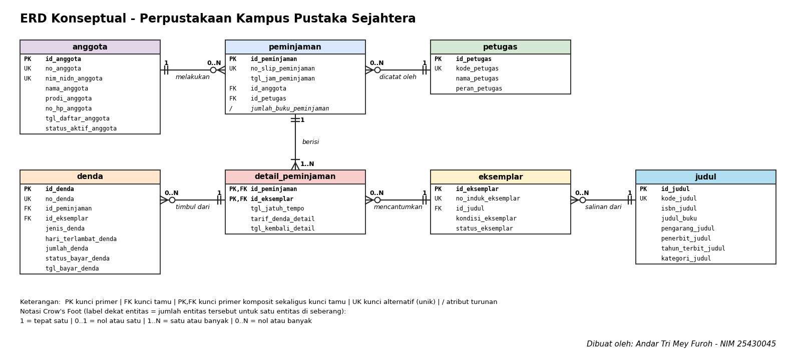

# ERD Proyek - Perpustakaan Kampus Pustaka Sejahtera (fiktif)

NIM: 25430045 · Praktikum Basis Data · Pertemuan 3 (Milestone Proyek 3)

Sumber diagram: `p03_erd_25430045.drawio` · Gambar: `p03_erd_25430045.png`

Dasar: `p02_kebutuhan_data_25430045.md` (parameter P = 1: maksimal 3 buku per transaksi, denda Rp1.000 per hari).

## 1. Entitas, atribut, dan kunci

| Entitas | Kunci primer | Kunci tamu | Kunci alternatif | Atribut turunan | Jumlah atribut |
|---|---|---|---|---|---:|
| anggota | id_anggota | - | no_anggota, nim_nidn_anggota | - | 8 |
| peminjaman | id_peminjaman | id_anggota, id_petugas | no_slip_peminjaman | jumlah_buku_peminjaman | 6 |
| petugas | id_petugas | - | kode_petugas | - | 4 |
| denda | id_denda | id_peminjaman, id_eksemplar | no_denda | - | 9 |
| detail_peminjaman | id_peminjaman, id_eksemplar | id_peminjaman, id_eksemplar | - | - | 5 |
| eksemplar | id_eksemplar | id_judul | no_induk_eksemplar | - | 5 |
| judul | id_judul | - | kode_judul | - | 8 |

Entitas asosiatif: **`detail_peminjaman`** menghubungkan `peminjaman` dan `eksemplar` (banyak-ke-banyak) dan memiliki atribut sendiri, yaitu `tgl_jatuh_tempo`, `tarif_denda_detail`, dan `tgl_kembali_detail`. Kunci primernya komposit (`id_peminjaman`, `id_eksemplar`).

Atribut di luar kamus Pertemuan 2 (perlu ditambahkan ke kamus bila disetujui): `penerbit_judul` dan `kategori_judul` (ada di entitas kandidat), `jenis_denda` (membedakan denda terlambat dari denda buku hilang/rusak sesuai AB-10), serta kunci pengganti `id_*`.

## 2. Relasi dan kardinalitas

| Relasi | Sisi kiri | Sisi kanan | Dasar |
|---|---|---|---|
| anggota melakukan peminjaman | tepat satu anggota | nol atau banyak peminjaman | AB-03, AB-08 |
| petugas mencatat peminjaman | tepat satu petugas | nol atau banyak peminjaman | PB-02 (slip memuat petugas) |
| peminjaman berisi detail_peminjaman | tepat satu peminjaman | satu atau banyak detail (maksimal 3) | AB-01, AB-02 |
| eksemplar tercantum di detail_peminjaman | tepat satu eksemplar | nol atau banyak detail (bergantian dari waktu ke waktu) | AB-05 |
| judul memiliki eksemplar | tepat satu judul | nol atau banyak eksemplar | AB-09, PB-05 |
| detail_peminjaman menimbulkan denda | tepat satu detail | nol atau banyak denda | AB-04, AB-06, AB-10 |

Pada diagram, batas maksimal 3 buku (AB-02) ditulis sebagai 1..N karena notasi Crow's Foot tidak menyatakan angka tertentu. Batas itu dijaga oleh aturan bisnis dan program, bukan oleh struktur tabel.

## 3. Penelusuran KI ke jalur ERD

| KI | Kebutuhan informasi | Jalur pada ERD | Atribut yang dipakai |
|---|---|---|---|
| KI-01 | Jumlah transaksi peminjaman per hari dan bulan | peminjaman → detail_peminjaman | tgl_jam_peminjaman |
| KI-02 | Lima judul terpopuler per bulan | detail_peminjaman → eksemplar → judul | id_eksemplar, judul_buku |
| KI-03 | Eksemplar melewati jatuh tempo dan peminjamnya | detail_peminjaman → peminjaman → anggota (dan eksemplar) | tgl_jatuh_tempo, tgl_kembali_detail, nama_anggota |
| KI-04 | Total denda terbayar dan belum terbayar per bulan | denda | jumlah_denda, status_bayar_denda, tgl_bayar_denda |
| KI-05 | Sepuluh anggota paling aktif meminjam | anggota → peminjaman → detail_peminjaman | id_anggota, id_peminjaman |
| KI-06 | Jumlah eksemplar tersedia per judul | judul → eksemplar | status_eksemplar |

Semua KI dapat ditelusuri. Aturan AB-07 (denda belum lunas menahan peminjaman baru) dijawab melalui jalur denda → detail_peminjaman → peminjaman → anggota dengan syarat `status_bayar_denda` = Belum lunas.

## 4. Pemetaan entitas ke proses bisnis dan KI

| Entitas | Proses bisnis (Pertemuan 2) | KI |
|---|---|---|
| anggota | PB-01 (C, U), dibaca PB-02, PB-03, PB-04, PB-07 | KI-03, KI-05 |
| petugas | PB-06 (C, U), dibaca PB-01 sampai PB-04, PB-07 | - |
| judul | PB-05 (C, U), dibaca PB-02, PB-07 | KI-02, KI-06 |
| eksemplar | PB-05 (C, U), PB-02 dan PB-03 (R, U status) | KI-02, KI-03, KI-06 |
| peminjaman | PB-02 (C), PB-03 (R) | KI-01, KI-03, KI-05 |
| detail_peminjaman | PB-02 (C), PB-03 (U) | KI-01, KI-02, KI-03, KI-05 |
| denda | PB-03 (C), PB-04 (U) | KI-04 |

## 5. Standar kelengkapan ERD (Tabel 3.3)

- [x] Nama tabel huruf kecil tunggal di kepala kotak, satu warna per entitas
- [x] Semua atribut dari kamus data tercantum (bukan hanya kunci)
- [x] Kunci primer berlabel PK, kunci tamu FK, kunci primer komposit PK,FK
- [x] Kedua ujung garis memakai Crow's Foot dan label angka (1, 0..1, 0..N, 1..N)
- [x] Garis ditarik dari kunci primer ke kunci tamu yang dirujuk, tidak saling menumpuk
- [x] Kotak legenda simbol dan label di bagian bawah diagram
- [x] Tanda tangan digital (nama dan NIM) di sudut diagram
- [x] Minimal satu entitas asosiatif dengan atribut sendiri (`detail_peminjaman`)

## 6. Catatan tinjauan klien

Isi dengan umpan balik asli dari teman sekelas (minimal dua).

| No | Pemberi umpan balik | Umpan balik | Keputusan | Alasan |
|---|---|---|---|---|
| 1 | [ISI NAMA TEMAN] | [ISI UMPAN BALIK 1] | [Diterima / Ditolak] | [ISI ALASAN] |
| 2 | [ISI NAMA TEMAN] | [ISI UMPAN BALIK 2] | [Diterima / Ditolak] | [ISI ALASAN] |
