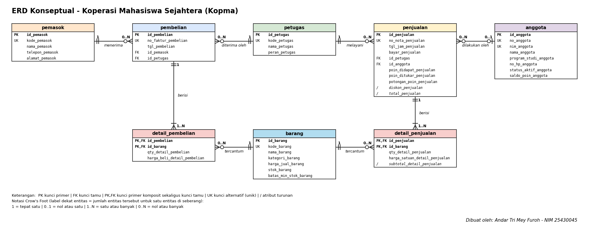

# ERD Kopma - Koperasi Mahasiswa Sejahtera

NIM: 25430045 · Praktikum Basis Data · Pertemuan 3 (studi kasus Kopma)

Sumber diagram: `p03_erd_kopma_25430045.drawio` · Gambar: `p03_erd_kopma_25430045.png`

## 1. Entitas, atribut, dan kunci

| Entitas | Kunci primer | Kunci tamu | Kunci alternatif | Atribut turunan | Jumlah atribut |
|---|---|---|---|---|---:|
| pemasok | id_pemasok | - | kode_pemasok | - | 5 |
| pembelian | id_pembelian | id_pemasok, id_petugas | no_faktur_pembelian | - | 5 |
| petugas | id_petugas | - | kode_petugas | - | 4 |
| penjualan | id_penjualan | id_petugas, id_anggota | no_nota_penjualan | diskon_penjualan, total_penjualan | 11 |
| anggota | id_anggota | - | no_anggota, nim_anggota | - | 8 |
| detail_pembelian | id_pembelian, id_barang | id_pembelian, id_barang | - | - | 4 |
| barang | id_barang | - | kode_barang | - | 7 |
| detail_penjualan | id_penjualan, id_barang | id_penjualan, id_barang | - | subtotal_detail_penjualan | 5 |

Catatan kunci: setiap entitas memakai kunci pengganti `id_*`. Nomor anggota, NIM, nomor nota, kode barang, dan sejenisnya menjadi kunci alternatif (unik). Entitas asosiatif `detail_penjualan` dan `detail_pembelian` memakai kunci primer komposit (kunci tamu dari kedua entitas induknya). Atribut `id_anggota` pada `penjualan` boleh kosong karena pembeli umum tidak berstatus anggota (AB-02).

## 2. Relasi dan kardinalitas

| Relasi | Sisi kiri | Sisi kanan | Dasar |
|---|---|---|---|
| petugas melayani penjualan | tepat satu petugas | nol atau banyak penjualan | wawancara kasir, PB-02 |
| anggota melakukan penjualan | nol atau satu anggota | nol atau banyak penjualan | AB-02 |
| penjualan berisi detail_penjualan | tepat satu penjualan | satu atau banyak detail | AB-01 |
| barang tercantum di detail_penjualan | tepat satu barang | nol atau banyak detail | AB-04 |
| pemasok menerima pembelian | tepat satu pemasok | nol atau banyak pembelian | AB-06 |
| pembelian berisi detail_pembelian | tepat satu pembelian | satu atau banyak detail | faktur pemasok |
| barang tercantum di detail_pembelian | tepat satu barang | nol atau banyak detail | faktur pemasok, PB-04 |
| petugas menerima pembelian | tepat satu petugas | nol atau banyak pembelian | AB-11 (baru, lihat bagian 6) |

Dua baris pertama dan keempat sampai ketujuh mengikuti Tabel 3.2 buku. Baris "barang tercantum di detail_pembelian" saya tambahkan karena `detail_pembelian` perlu merujuk barang yang dibeli, dan baris terakhir muncul dari Titik Analisis 3.

## 3. Penelusuran kebutuhan informasi (KI) ke jalur ERD

| KI | Kebutuhan informasi | Jalur pada ERD | Atribut yang dipakai |
|---|---|---|---|
| KI-01 | Omzet dan jumlah nota per hari/bulan | penjualan → detail_penjualan | tgl_jam_penjualan, qty, harga_satuan |
| KI-02 | Lima barang terlaris per bulan | detail_penjualan → barang | qty_detail_penjualan, nama_barang |
| KI-03 | Barang di bawah batas minimum stok | barang | stok_barang, batas_min_stok_barang |
| KI-04 | Sepuluh anggota dengan belanja terbesar | anggota → penjualan → detail_penjualan | id_anggota, qty, harga_satuan |
| KI-05 | Total poin diberikan dan ditukar per bulan (latihan P2) | penjualan | poin_didapat_penjualan, poin_ditukar_penjualan |
| KI-06 | Anggota dengan saldo poin minimal 50 (latihan P2) | anggota | saldo_poin_anggota |
| KI-07 (usulan) | Petugas gudang yang menerima barang dari pemasok | petugas → pembelian → pemasok | id_petugas, id_pemasok |

Semua KI dapat ditelusuri. KI-07 baru dapat dijawab setelah relasi petugas–pembelian ditambahkan.

## 4. Pemetaan entitas ke proses bisnis dan KI

| Entitas | Proses bisnis (Pertemuan 2) | KI |
|---|---|---|
| anggota | PB-01 (C), PB-02 (R, U saldo poin), PB-05 (R) | KI-04, KI-06 |
| barang | PB-02 (R, U stok), PB-03 (R), PB-04 (U) | KI-02, KI-03 |
| penjualan | PB-02 (C), PB-05 (R) | KI-01, KI-04, KI-05 |
| detail_penjualan | PB-02 (C), PB-05 (R) | KI-01, KI-02, KI-04 |
| pemasok | PB-06 (C, U), PB-03/PB-04 (R) | KI-07 |
| pembelian | PB-03 (C), PB-04 (U) | KI-07 |
| detail_pembelian | PB-03 (C), PB-04 (U) | - |
| petugas | dibaca oleh PB-02, PB-04 | KI-07 |

Temuan: entitas `petugas` tidak punya kolom pada matriks CRUD Pertemuan 2, sehingga belum ada proses yang membuatnya. Ini perlu ditambahkan (misalnya proses mengelola data petugas oleh ketua) dan dicatat sebagai perubahan, bukan dihapus diam-diam.

## 5. Standar kelengkapan ERD (Tabel 3.3)

- [x] Nama tabel huruf kecil tunggal di kepala kotak, satu warna per entitas
- [x] Semua atribut dari kamus data tercantum (bukan hanya kunci)
- [x] Kunci primer berlabel PK, kunci tamu FK, kunci primer komposit PK,FK
- [x] Kedua ujung garis memakai Crow's Foot dan label angka (1, 0..1, 0..N, 1..N)
- [x] Garis ditarik dari kunci primer ke kunci tamu yang dirujuk, tidak saling menumpuk
- [x] Kotak legenda simbol dan label di bagian bawah diagram
- [x] Tanda tangan digital (nama dan NIM) di sudut diagram

## 6. Keputusan dan perubahan

1. **Relasi petugas–pembelian (Titik Analisis 3).** ERD awal belum bisa menjawab petugas gudang mana yang menerima barang. Saya menambah relasi petugas menerima pembelian (`pembelian.id_petugas`) dan mencatatnya sebagai aturan bisnis baru **AB-11**: setiap pembelian yang diterima dicatat petugas penerimanya (berperan gudang). Nomor AB-07 sampai AB-10 sudah terpakai pada latihan poin loyalitas Pertemuan 2.
2. **Poin loyalitas (latihan E.1).** Saya memilih atribut `saldo_poin_anggota` pada `anggota`, sedangkan poin per transaksi tersimpan di `penjualan`. Entitas riwayat poin tidak dibuat karena riwayat sudah terekam per nota (AB-10).
3. **Atribut turunan.** `diskon_penjualan`, `total_penjualan`, dan `subtotal_detail_penjualan` ditandai turunan (`/`). Keputusan disimpan atau dihitung ditunda ke Pertemuan 4.

## 7. Catatan tinjauan klien

Isi dengan umpan balik asli dari teman yang berperan sebagai ketua Kopma (minimal dua).

| No | Pemberi umpan balik | Umpan balik | Keputusan | Alasan |
|---|---|---|---|---|
| 1 | alfazri |  ERD Kopma ini sudah bisa menjawab petugas mana yang menerima barang dari pemasok| Diterima  | ya benar bisa menjawab |
| 2 | fadillah | menurut saya,gambar ini menyimpan data dalam 4 kelompok yaituorang, barang, penjuall, dan pembeli | Diterima | ya benar memang dalam 4 kelompok |
    